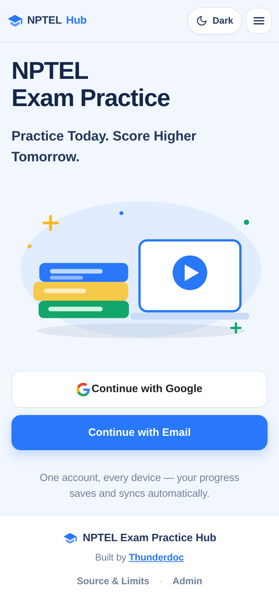
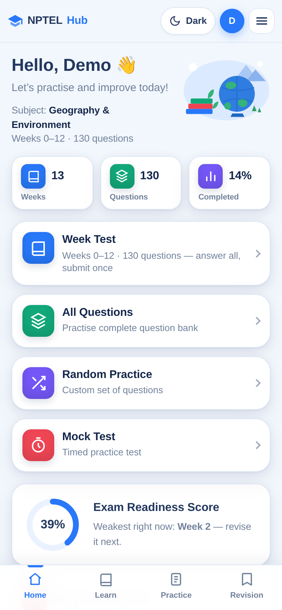
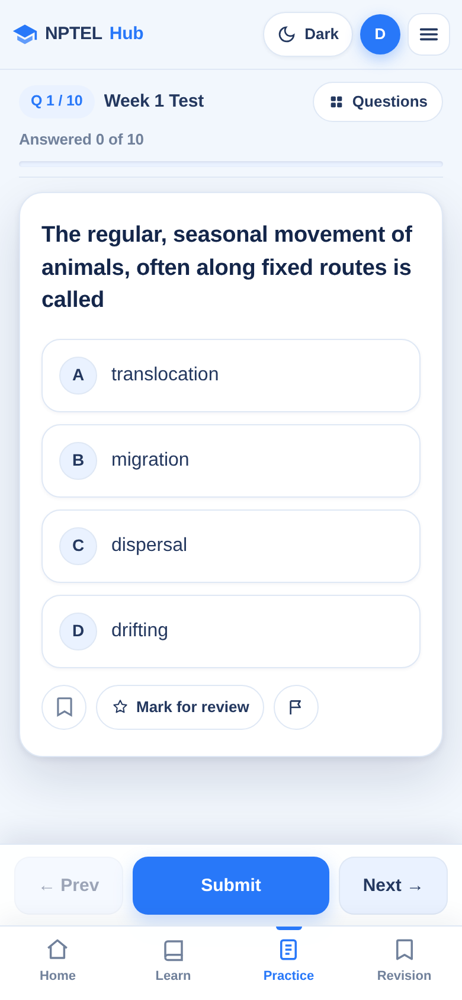
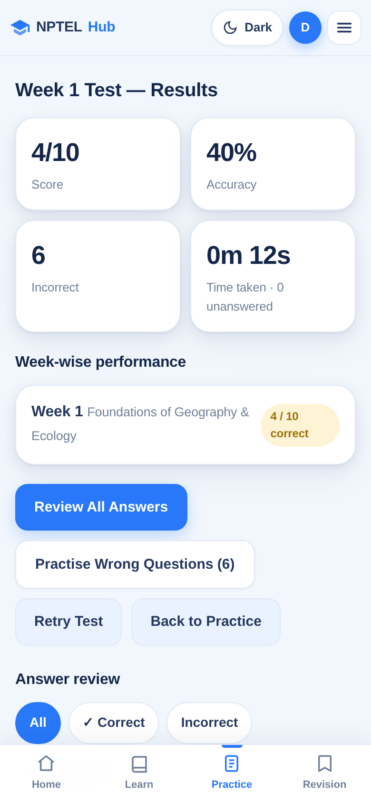
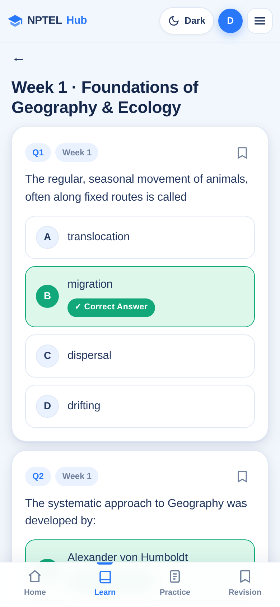
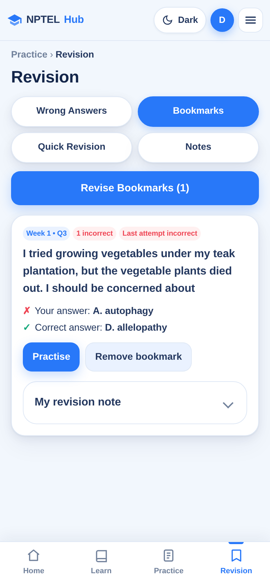
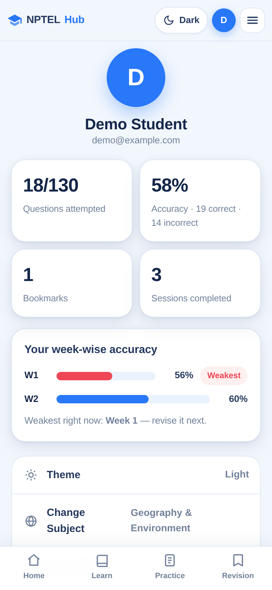
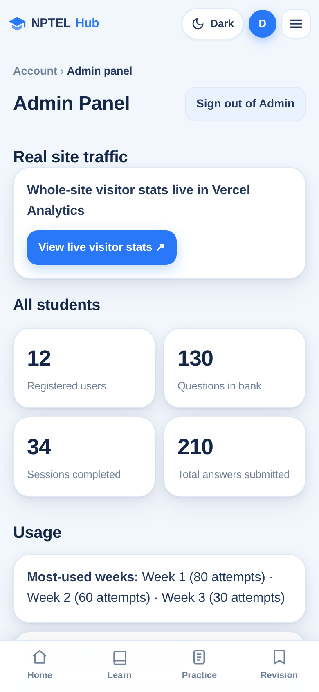
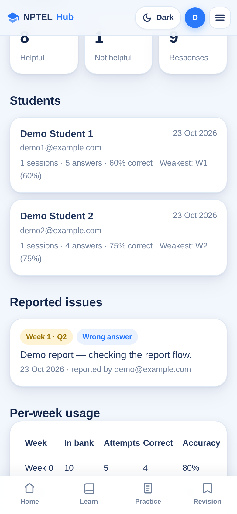

<div align="center">


# 📚 NPTEL Exam Practice Hub

### Practice Today. Score Higher Tomorrow.

**A free, mobile-first practice app for NPTEL students — 130 verified assignment questions for
*Geography & Environment*, with submit-all week tests, timed mocks, green-answer study questions
and smart revision. Sign in with Google or email, and your progress syncs across devices.**

[](https://nptel-exam-practice-hub.vercel.app)

[](data/questions.json)
[](#-question-bank--verification)
[](LICENSE)
[](docs/ARCHITECTURE.md)

**👉 [nptel-exam-practice-hub.vercel.app](https://nptel-exam-practice-hub.vercel.app)**

*No build step. Free to use. Just open, sign in, and practise.*

**Built by [Thunderdoc](https://github.com/Thunderdoc)**

</div>

---

## 🎯 What it is — and who it's for

The NPTEL Exam Practice Hub turns the *Geography & Environment* assignment set into a complete
exam-preparation app that runs in the browser. It is made for **students enrolled in the
course** who want to practise the real assignment questions the way the exam actually feels:
attempt everything first, submit once, then analyse.

- 📱 **Mobile-first** — designed for phone and tablet screens (320–430px, 768–1024px)
- 🌗 **Light & dark themes**, remembered per account
- ☁️ **Synced accounts** — Google sign-in or email/password via Firebase; your attempts,
  bookmarks, notes and sessions follow you across devices (a local copy keeps the app usable offline)
- 🧭 **Simple navigation** — four tabs only: Home · Learn · Practice · Revision
- ⚡ **Instant** — a dependency-free static site on Vercel; no loading spinners, no own server

---

## 📸 Screenshots

Captured from the shipped build's exact bytes (390px viewport). Inner screens are signed in
with a **demo account**, so their progress numbers are illustrative, not real usage — the
questions, answers and layouts are the real shipped UI.

| Welcome — clean sign-in | Home (demo account) |
| --- | --- |
|  |  |
| Google or email sign-in. No subject or question-count clutter on login, by design. | Modes, readiness score and weakest week at a glance. |

| Week Test in progress | Results after submit (demo attempt) |
| --- | --- |
|  |  |
| Answer all, submit once — no reveals mid-attempt. | Score, week-wise performance and full answer review. |

| Learn — study a week | Revision — bookmarks (demo account) |
| --- | --- |
|  |  |
| Read a week with the correct answer in green. | Your answer vs the correct answer, plus your own note. |

| Account (demo account) | Admin overview (demo data) |
| --- | --- |
|  |  |
| Progress, week-wise accuracy, theme and exam date. | Global aggregates; visitor stats live in Vercel Analytics. |

| Admin students list (demo data) |
| --- |
|  |
| Per-student progress — visible only to the owner's verified Google identity. |

---

## ✨ Features

### 📝 Practice — submit-all, like the real exam
No per-question peeking: in every practice mode you attempt **all** questions first, then submit
**once** and get your score plus a full review (wrong answers show the correct answer in green).

- **Week Test** — one week at a time, Weeks 0–12, with an unanswered count before you confirm
- **All Questions** — the full 130-question bank in one session
- **Random Practice** — a shuffled set from the whole bank
- **Custom Practice Generator** — pick weeks × number of questions × pool (New / Incorrect / Bookmarked)

Every session uses the same clean layout: a slim progress header, the question palette tucked
into a bottom sheet, and exactly **one Submit** in the bottom bar.

### ⏱️ Timed Mock
Exam-style timed sessions with the palette in a bottom sheet (answered / marked-for-review /
current), navigation that never reveals answers mid-attempt, a submit confirmation, and a
complete post-submit analysis. The timer auto-submits at expiry.

### 📖 Learn — study the questions, answers shown
- **Study Questions** — pick any week (0–12) and simply *read* that week's questions with all
  four options and the **correct answer highlighted in green** — nothing to tap, nothing to
  submit. Bookmark any question straight into Revision, and walk week to week with the
  Previous / Next week buttons. The fastest way to revise the night before.

### 🔁 Revision
- **Wrong Answers** — every question you've missed, sorted by how often you've missed it, with one-tap weak-week practice
- **Bookmarks** — save any question (including from Learn's study cards) and revise or practise them together
- **Quick Revision flashcards** — flip, self-mark *Remembered* / *Need Revision*
- **Notes** — your own notes on questions, kept per account

### 📊 Know where you stand
- **Exam Readiness Score** — an honest estimate from coverage + accuracy + tests completed,
  labelled an *estimate, not a guarantee*
- **Week-wise accuracy bars** from your own attempts, weakest week marked
  (on Home and in Account)
- **Exam date** — set your exam date on the Account page; the app counts down to it

### 🛠️ Accounts, sync & admin
- **Firebase accounts** — sign in with Google (popup on desktop, full-page redirect on phones)
  or email/password; the app itself stores **no passwords**. **Remember me** drives session
  persistence: ticked = stay signed in across browser restarts, unticked = this browser session only.
- **Cloud sync** — attempts, bookmarks, notes, sessions, revision flags, feedback and exam date
  live in Cloud Firestore (`users/{uid}`) and sync across devices; a local copy keeps the app
  usable when offline. Old device-local accounts from before the Firebase switch are retired —
  signing in with the same email migrates that device's old progress once.
- **Report an Issue** — flag any question; reports go to the admin panel's issues list
- **"Did this app help you?"** — a 👍/👎 student feedback prompt, counted globally
- **Admin panel** — global aggregates (registered users, sessions, per-week and per-question
  usage, feedback, reported issues) plus a **students list** with per-student progress
  (sessions, answers + accuracy, weakest weeks, last activity). The students list is readable
  only by the owner's verified Google identity under the published Firestore rules; the
  password gate remains as a fallback. Real site traffic is linked separately from
  Vercel Web Analytics.

---

## 📚 Question bank & verification

`data/questions.json` holds all **130 questions** — 4 options each, one accepted answer each
(the same bank is embedded in `assets/js/app.js`, so the app also runs as a single
self-contained page):

| Weeks | 0 | 1 | 2 | 3 | 4 | 5 | 6 | 7 | 8 | 9 | 10 | 11 | 12 |
| --- | --- | --- | --- | --- | --- | --- | --- | --- | --- | --- | --- | --- | --- |
| **Questions** | 10 | 10 | 10 | 10 | 10 | 10 | 10 | 10 | 10 | 10 | 10 | 10 | 10 |

**How the answers were verified**

- 🎓 **Weeks 1–12 are complete and portal-verified.** On 2026-10-23, every one of the 120
  questions was re-verified one-by-one against the Accepted Answers in the course owner's own
  NPTEL portal — **120/120 match, 0 differences**.
- 🔁 The original 113-question export records every answer **twice** (a ✓ mark *and* a
  `Correct Answer:` line) — an automated comparison found **0 mismatches**.
- 🧩 The 7 questions missing from that export (W6 Q10 · W7 Q1, Q9 · W9 Q1 · W10 Q1 · W11 Q1, Q5)
  were **recovered from the portal — never invented**.
- 🌱 **Week 0** is the course orientation week. The portal shows no accepted answers for it, so
  its 10 answers were sourced and verified from **public course material** — the only answers in
  the bank not taken from an NPTEL accepted-answer record, and labelled as such in the app.
- 🏛️ NPTEL publishes no public answer key for this course (keys live in the enrolled portal) —
  **no answer is ever "corrected" from a third-party site.**

Full report: **[docs/VERIFICATION.md](docs/VERIFICATION.md)**

> **No explanations:** the source contains no explanations for any question, so the app never
> invents one — it honestly says *"No explanation in source."* Your own notes are labelled as yours.

---

## 🚀 Quick start (students)

1. Open **[nptel-exam-practice-hub.vercel.app](https://nptel-exam-practice-hub.vercel.app)**
2. Sign in with Google or email, and pick the subject
3. Set your **exam date** on the Account page so the countdown can guide you
4. Start a **Week Test**, or open **Learn** to read a week with answers in green
5. Revisit **Revision** for your wrong answers and bookmarks before the exam

**Run it locally**

```bash
git clone https://github.com/Thunderdoc/nptel-exam-practice-hub.git
cd nptel-exam-practice-hub
python3 -m http.server 8000   # then open http://localhost:8000
```

`localhost` is an authorised Firebase domain, so sign-in works locally too. Note: the
committed `assets/js/firebase-config.js` points at this project's Firebase backend — if you
deploy your own copy, register your own Firebase project and replace that config (and publish
matching Firestore rules) instead of reusing these values.

**Deploy your own copy:** import this repo in [Vercel](https://vercel.com/new) with framework
preset **Other** — no build command. Pushes to `main` deploy automatically. App assets are
cache-busted with a `?v=` token in `index.html` (bumped on every asset change) so shipped
fixes actually reach phones instead of hiding behind stale caches.

---

## 🧰 Tech

- **Vanilla HTML, CSS & JavaScript** — zero dependencies, zero build step
- **Static hosting on Vercel**, auto-deployed from `main`
- **Firebase Authentication** (Google + email/password) and **Cloud Firestore** for accounts
  and sync — see **[docs/BACKEND.md](docs/BACKEND.md)** for schema, rules and honest limits
- **Persistence:** Firestore document per student, with browser `localStorage` as an offline
  cache (in-progress sessions never leave the device)
- The question bank lives both as `data/questions.json` and embedded in `assets/js/app.js`
  (identical copies, 130 questions each)

## 🗂️ Project structure

```
nptel-exam-practice-hub/
├── index.html              # App markup (screens & templates)
├── assets/
│   ├── css/style.css       # Design system — light + dark themes
│   └── js/
│       ├── app.js          # App logic — auth, practice, mock, learn, revision, admin
│       └── firebase-config.js  # Firebase project identifiers (public, not secrets)
├── data/
│   └── questions.json      # The verified 130-question bank (Weeks 0–12)
├── docs/
│   ├── ARCHITECTURE.md     # How the code is organised + how to extend the bank
│   ├── BACKEND.md          # Firebase schema, rules, migration, limits
│   ├── VERIFICATION.md     # How every accepted answer was verified
│   └── images/             # Screenshots used above
├── CHANGELOG.md
├── STATUS.md               # Phase-2 build log
├── LICENSE                 # MIT (app code; see its note on question content)
└── vercel.json             # Static deploy config + cache headers
```

How the code is organised, section by section: **[docs/ARCHITECTURE.md](docs/ARCHITECTURE.md)**

## ➕ Adding future subjects & sessions

The bank is **fully data-driven** — week lists, counts, pools and statistics are derived from
the data at runtime, so a new NPTEL session (questions change every session) or a new subject is a
**data change, not a code change**: add verified entries to `data/questions.json` and the embedded
bank in the same format, add a week title if needed, update the stated totals, and push. The full
procedure (including session versioning) is in **[docs/ARCHITECTURE.md](docs/ARCHITECTURE.md)**.

---

## 🗺️ Roadmap

- **Audited backend** — move the global rollup and admin access behind Cloud Functions and
  admin custom claims, so counters and the students list are no longer trust-based client writes
  (today's honest limits are in **[docs/BACKEND.md](docs/BACKEND.md)**)
- **More subjects & sessions** — the bank format already supports them; each new set needs
  portal-verified answers, never invented ones

---

## 📄 License

[MIT](LICENSE) — free to use, learn from and build on. Note: the licence covers the
application code; the question content in `data/questions.json` comes from a supplied NPTEL
assignment export and is included for students' personal exam revision, not for redistribution
beyond that purpose.

**Built by [Thunderdoc](https://github.com/Thunderdoc)** — for NPTEL students preparing for their exam. Good luck! 🍀
